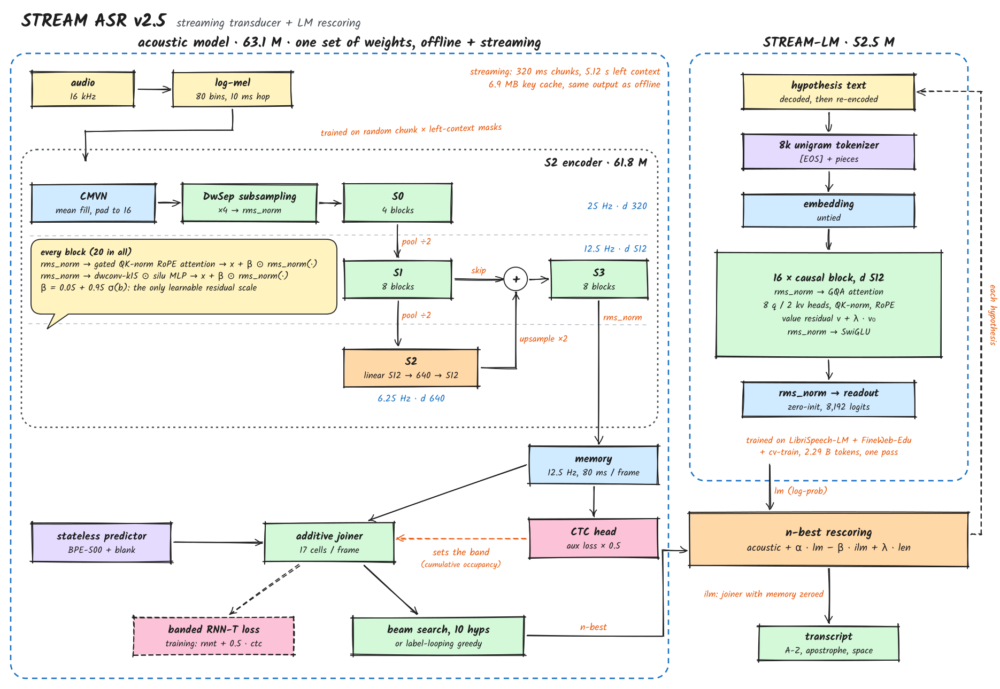

# STREAM ASR

[](LICENSE)
[](https://www.python.org/)
[](https://pytorch.org/)

**S**treaming **T**ransducer with **R**esidual-bounded **E**ncoder-**A**coustic **M**odeling: a
from-scratch streaming speech recognizer for English, trained end to end on LibriSpeech 960 h and
Common Voice English on a single 12 GB consumer GPU.

* **One model, two modes.** The same weights decode offline and streaming (320 ms chunks).
* **Small and fast.** 63.1 M parameters; streaming real-time factor 0.05 with beam search and LM
  rescoring, 13 ms to a first partial after each 320 ms chunk, and a constant 6.9 MB streaming state
  for any stream length.
* **Cheap to train.** 35.7 h from scratch on one RTX 5070, with no pretrained weights: the acoustic
  model sees only LibriSpeech and Common Voice.
* **Pure PyTorch.** No k2, icefall or external decoder: the banded RNN-T loss, Muon optimizer,
  label-looping decoder and beam search are all in this repository.

## Results

Test WER (%, offline / streaming) of `transducer_avg.pt` + STREAM-LM. Rescoring weights are tuned on
the matching dev set, never on test; Common Voice is the hard, accent-rich condition.

| Decoding | LibriSpeech test-clean | LibriSpeech test-other | Common Voice test |
|---|---|---|---|
| greedy | 2.83 / 3.80 | 6.55 / 9.07 | 15.69 / 20.07 |
| beam 10 | 2.89 / 3.76 | 6.50 / 8.75 | 15.43 / 19.31 |
| beam 10 + LM + ILME | **2.29 / 2.88** | **5.46 / 7.19** | **13.42 / 16.80** |

One fixed rescoring setting (α 0.8, β 0.2, length bonus 0.5) stays within 0.05 points of the tuned
row on all six figures.

Streaming is 320 ms chunks with 5.12 s of left context. On one RTX 5070: RTF 0.017 to 0.018 offline
and 0.046 to 0.048 streaming with the LM, 11 to 14 ms to first partial, about 0.1 s to finalize.
Full tables, the budget curve and the tuned weights are in
[MODEL_ARCHITECTURE.md §12](MODEL_ARCHITECTURE.md#12-results).

## Quickstart: transcribe with the released weights

```bash
git clone --branch v2.5 https://github.com/PanzerPeter/STREAM-ASR.git && cd STREAM-ASR
uv venv .venv --python 3.12 && uv pip install -r requirements.txt

V=release/stream-asr-v2.5
gh release download v2.5 -D $V -p '*.safetensors'
(cd $V && sha256sum -c SHA256SUMS)

.venv/bin/python -m src.slices.Decode.streaming_decode AUDIO.flac \
    --checkpoint $V/model.safetensors --tokenizer $V/bpe500.model             # streaming
.venv/bin/python -m src.slices.Decode.streaming_decode AUDIO.flac --offline \
    --checkpoint $V/model.safetensors --tokenizer $V/bpe500.model             # offline
```

Input is 16 kHz mono speech. [release/stream-asr-v2.5/README.md](release/stream-asr-v2.5/README.md)
is the model card: files, LM rescoring (`--lm-weight` and the LM's own files), the local web demo,
and limitations.

## Train from scratch

Needs the LibriSpeech corpus under `data/{Train,Val,Test}` and Common Voice Scripted Speech 27.0
English extracted into `data/CommonVoice/`, about 350 GB of disk (both corpora, ~210 GB of feature
cache, the LM corpus) plus 95 GB for the Common Voice archive until it is extracted, network access
for the LM text (FineWeb-Edu), and a CUDA GPU. The recipe was built on an RTX 5070 (12 GB, Blackwell
sm_120, CUDA 12.8 wheels); `verify_env.py` checks for exactly that card, so edit its expected
capability on other hardware and re-run `scripts/profile_transducer_step.py` before trusting the
batch budgets.

```bash
uv venv .venv --python 3.12 && source .venv/bin/activate
uv pip install -r requirements.txt
python scripts/verify_env.py

# data: LibriSpeech + Common Voice manifests, BPE-500 tokenizer, 2x speed-perturbed manifest,
# CMVN, fp16 mel cache
PYTHONPATH=. python scripts/build_manifests.py
PYTHONPATH=. python scripts/build_cv_manifests.py
PYTHONPATH=. python scripts/train_tokenizer.py
PYTHONPATH=. python scripts/build_speed_perturb_manifest.py
PYTHONPATH=. python scripts/compute_cmvn.py
PYTHONPATH=. python scripts/precompute_features.py

# transducer: 1.2M batches, ~36 h on an RTX 5070, then average the last five snapshots
python -m src.slices.TrainAcousticModel.train_transducer
PYTHONPATH=. python scripts/average_checkpoints.py --last-n 5

# STREAM-LM for rescoring (~7 h), then evaluate (tunes the LM weights on dev, reports on test)
python scripts/download_lm_text.py
PYTHONPATH=. python scripts/build_lm_corpus.py && PYTHONPATH=. python scripts/train_lm_tokenizer.py
PYTHONPATH=. python scripts/prepare_lm_data.py
python -m src.slices.TrainLanguageModel.train_lm
python -m src.slices.Evaluate.evaluate --clean
python -m src.slices.Evaluate.evaluate --other
python -m src.slices.Evaluate.evaluate --cv
```

[COMMANDS.md](COMMANDS.md) has every command and flag, the LM data preparation, and the failure
modes worth knowing first.

## How it works



* **Encoder.** A three-rate U-Net with 20 blocks. Each block is gated QK-norm RoPE attention, then a
  conv-gated MLP on its result, each a residual step `x + β ⊙ rms_norm(y)` with a per-channel gate
  `β = 0.05 + 0.95 σ(b)`.
* **Amplitude bounded by construction.** Every stack entry and the output are weightless RMSNorms and
  the floored gates are the only learnable residual-path scale, so no activation can grow without
  bound and no parameter is ever projected or clamped.
* **Banded RNN-T.** After a 10k-batch warmup the joiner and loss run on 17 lattice cells per frame
  around the CTC head's cumulative token count, repaired so both lattice terminals stay inside.
  The band's loss gap to the full lattice measured 0.0 throughout training.
* **Dynamic-chunk training.** Each batch samples a chunk size (full, 320 ms, 640 ms) and a left
  context (2.56 s, 5.12 s, unlimited), so one model serves both modes. Streaming decode is equal to
  the batched forward to fp32 round-off.
* **Decoding.** Exact label-looping greedy, a time-synchronous beam with recombination, and n-best
  rescoring with STREAM-LM minus an internal-LM estimate.

[MODEL_ARCHITECTURE.md](MODEL_ARCHITECTURE.md) covers every operator, the training recipe, the
invariants and how the recipe was chosen.

## Repository layout

```
config/                 pydantic-validated YAML, one file per section (authoritative values)
src/shared_kernel/      pure transforms + infra adapters (banded RNN-T loss, Muon, RoPE, IO, ...)
src/slices/
  BuildManifest/        manifests, 2x speed-perturbed manifest, BPE-500 tokenizer
  ComputeCmvn/          global mean/std over a train sample
  ExtractFeatures/      fp16 mel cache, dataset, frame-bucket sampler, SpecAugment (GPU)
  TrainAcousticModel/   S2 encoder, predictor, joiner, banded RNN-T + CTC trainer
  TrainLanguageModel/   STREAM-LM, the n-best rescorer
  Decode/               streaming / offline search + LM rescoring
  Evaluate/             WER/CER/RTF, edge errors, emission latency, dev-tuned weights
  Demo/                 local FastAPI upload + live-microphone UI
scripts/                data prep, checkpoint averaging, safetensors export, step profiler
tests/                  CPU suite (pytest), GPU gates under -m slow
release/                model cards, tokenizer and checksums per released version
docs/                   the README architecture sketch and the script that draws it
```

The code follows Vertical Slice Architecture ([VSA.md](VSA.md)): slices talk only through artifact
files and frozen command DTOs, and each slice's `CONTEXT.md` is its contract.

## License and attribution

STREAM ASR is open source under the [Apache License 2.0](LICENSE). Use it, modify it and ship it,
personally, academically or commercially, in open- or closed-source products, with no permission
needed and no royalty owed.

One thing is asked in return, and the license makes it binding (§4(d)): carry the [NOTICE](NOTICE)
file into anything you distribute that is built on this work, and credit it where you list your
other open-source components:

> Based on STREAM ASR (https://github.com/PanzerPeter/STREAM-ASR), Copyright 2026 PanzerPeter,
> licensed under Apache-2.0.

That covers the code, the trained checkpoints and the derived data artifacts alike. LibriSpeech is
distributed by its own authors under CC BY 4.0, Common Voice by Mozilla under CC0 1.0, and the
FineWeb-Edu text used for the language model under ODC-By 1.0; none of them is part of this
repository ([NOTICE](NOTICE) has the details).
